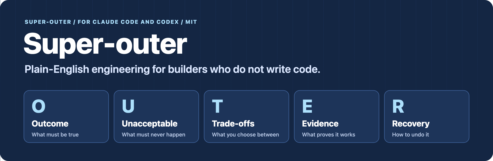
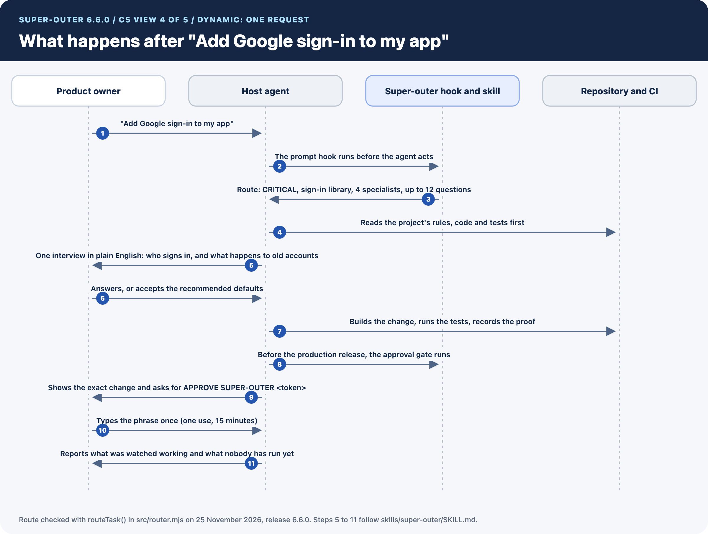
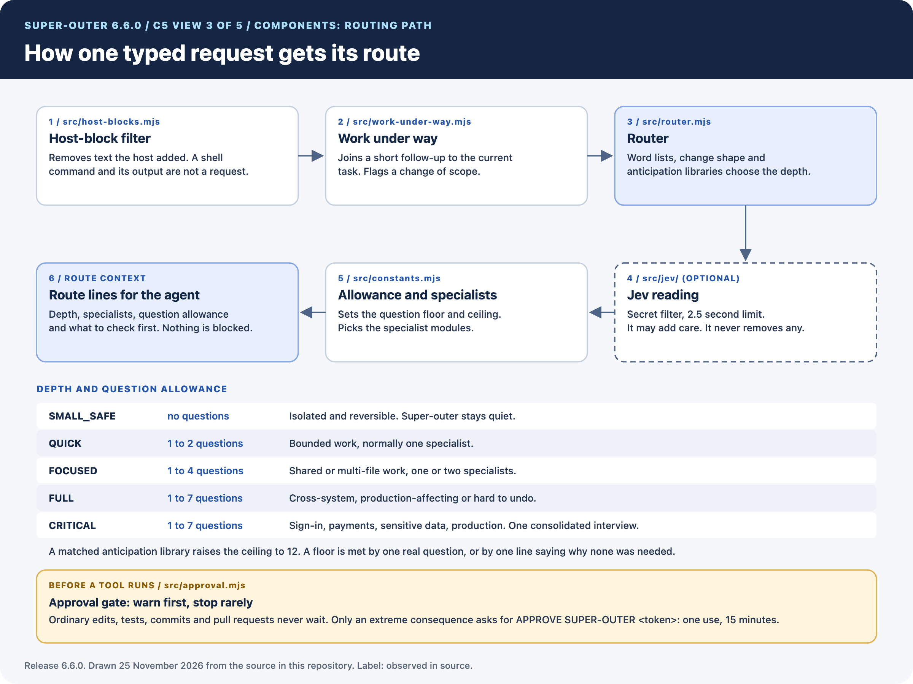
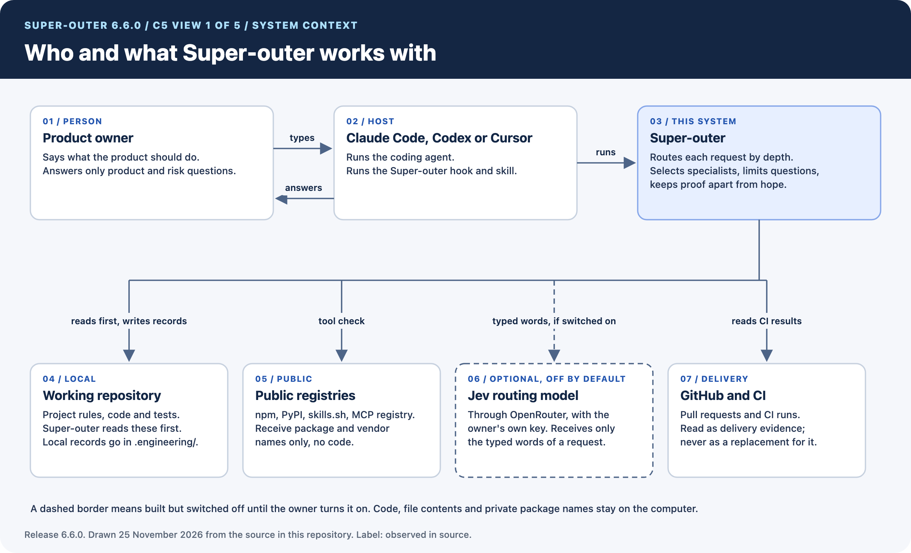

<p align="center">
  
</p>

<p align="center">MIT licence · Claude Code, Codex and Cursor</p>

Version: `6.6.0`. Platform support is macOS and Linux. Windows is unsupported.

> **About this text.** This README follows the writing rules of ASD-STE100
> Simplified Technical English. Sentences are short and use the active voice.
> Each instruction is one sentence. One term has one meaning.

## What Super-outer is

Super-outer is a plugin for coding agents. It plans and checks engineering work
for people who do not write code.

You tell the agent what the product must do. Super-outer reads your project
first. It decides how deep the work is. It selects the engineering specialists
that the work needs. It asks you only the questions that are yours to answer.
It requires evidence before the agent says "done". It asks you to type an
approval phrase only before an action that is very hard to undo.

**Who it is for:** product owners, founders, designers, teachers and other
builders who direct Claude Code or Codex but do not read code.

## OUTER

Super-outer asks five things about every material change.

| Letter | Word | The question |
|---|---|---|
| **O** | **Outcome** | What must be true for the people who use the product? |
| **U** | **Unacceptable** | What must never happen, for example lost data or a double charge? |
| **T** | **Trade-offs** | What do you give up for each choice, in cost, speed or risk? |
| **E** | **Evidence** | What proof shows that the change works, and where did someone see it work? |
| **R** | **Recovery** | How do we undo the change if it goes wrong? |

## How a request flows



1. **Routing by depth.** A hook reads each request before the agent acts. It
   gives the request one of five depths: `SMALL_SAFE`, `QUICK`, `FOCUSED`,
   `FULL` or `CRITICAL`.
2. **Specialists.** The router selects only the specialists that the work
   touches. There are twelve: product UI, frontend, backend, data, security,
   scale and cost, reliability, architecture, integrations, operations, AI and
   delivery.
3. **Question allowance.** Each depth has a limit. A small safe edit gets no
   questions. A `QUICK` task gets one or two. A `FOCUSED` task gets up to four.
   A `FULL` task gets up to seven. A `CRITICAL` task gets one consolidated
   interview. Each question comes with a recommended answer.
4. **Evidence.** Super-outer keeps each kind of proof separate. A test that
   someone wrote is not a test that someone ran. A passing local check is not
   a working live product. The final report tells you what was seen working and
   what nobody has run yet.
5. **Approval phrase.** Ordinary work never waits for you. Edits, tests,
   commits and pull requests continue. Before a very hard-to-undo action, such
   as a production release or a data deletion, the agent shows the exact change.
   Then it asks you to type `APPROVE SUPER-OUTER <token>`. The phrase works once,
   for 15 minutes.



## Install

You need [Node.js](https://nodejs.org/) 22 or newer, Git, and Claude Code or
Codex.

### Claude Code and Codex (recommended)

This route installs Super-outer for each host that it finds on your computer.

1. Clone the repository and open its folder:

```sh
git clone https://github.com/Shivak11/Super-outer.git
cd Super-outer
```

2. Run the setup:

```sh
npm run setup
```

3. Restart Claude Code and Codex after the setup finishes.
4. Run `npm run setup:verify` to see what is switched on.
5. Run `npm run setup:rollback` to restore every file that the setup changed.

The setup also installs the optional learning skills for both hosts. To
install only the main plugin, run `npm run setup -- --components none`.

### Claude Code only, from the plugin marketplace

Type these two commands in Claude Code:

```text
/plugin marketplace add Shivak11/Super-outer
/plugin install super-outer@super-outer
```

Then restart Claude Code. This route installs the plugin, its hook and its
skills. It does not change `~/.claude/CLAUDE.md`.

### Cursor

Run `npm run install:cursor` in the cloned folder. Then restart Cursor.

## First use

1. Open a project in Claude Code or Codex.
2. Type a request in your own words. For example: `Add Google sign-in to my app`.
3. Read the first reply. It names what the agent found in your project. It
   asks a small number of product questions, each with a recommendation.
4. Answer the questions, or reply `ok` to accept the recommendations.
5. Let the agent build and test the change.
6. Read the final report. It lists what was proven and what is still open.

You do not have to call Super-outer by name. The hook brings it in when the
work needs it. To call it directly, type `/super-outer:super-outer <request>` in
Claude Code or `$super-outer <request>` in Codex.

If you call the work a prototype, Super-outer keeps it light. It asks one
question at most and uses made-up data in a scratch folder.

## Companion skills

Four read-only skills ship with Super-outer. They change nothing until you
approve an item.

| Skill | What it does |
|---|---|
| `draw-system-diagram` | Draws architecture, pipeline and code-flow diagrams, and keeps them true to the code. |
| `edge-cases` | Lists the common ways a change can break, ranked by how often each breaks real software. |
| `jev-opportunities` | Finds AI calls that only pick from fixed answers and can run cheaper. |
| `caveman-opportunities` | Finds text that only machines read and can be shorter. |

## What it never asks you

- It never asks you to choose a library, a framework or an algorithm.
- It never asks a question that your project files already answer.
- It never asks again for a rule that you stated once in the project.
- It never asks for approval of edits, tests, commits or pull requests.
- It never asks you to paste a password or a key into the chat.
- It never shows you specialist names, scores, hashes or branch mechanics,
  unless you ask for the technical detail.

## Results


| Run | Cases | Mean score with Super-outer | Mean score without |
|---|---|---|---|
| Version 5.10.0, 12 October 2026 | 7 behaviour cases | 0.82 | 0.57 |
| Version 6.6.0, 18 November 2026 | 5 journey-map cases | 0.79 | 0.55 |

On 12 October 2026, the routing model chose the design path correctly for 118
of 120 held-out requests. The method notes, all scores and the raw result files
are in [evals/reports/](evals/reports/README.md). Run `npm run eval:check` to
check the eval suite offline.

## How it differs from developer workflows

Many agent workflows are written for developers. They expect the user to read
code, choose tools and judge test output. Super-outer expects the owner to
judge outcomes, risk and recovery, and it keeps the engineering detail in its
own records.

## Architecture

The five C5 views show the system at release 6.6.0. Each view has an SVG
source and a PNG copy.

| View | Shows |
|---|---|
| [1. System context](docs/architecture/views/01-system-context.png) | Who and what Super-outer works with |
| [2. Containers](docs/architecture/views/02-containers.png) | The parts that run, and where they live |
| [3. Components](docs/architecture/views/03-components-routing.png) | How one typed request gets its route |
| [4. Dynamic view](docs/architecture/views/04-dynamic-one-request.png) | The steps of one request |
| [5. Evidence and status](docs/architecture/views/05-evidence-status.png) | How proof stays apart, and what this release has proven |



Read [docs/architecture/index.md](docs/architecture/index.md) for the views and
the decisions. Read [docs/reference.md](docs/reference.md) for every command.

## What stays on your computer

Your code, your file contents and your private package names stay on your
computer. The tool check sends only public package and vendor names to public
registries such as npm and skills.sh.

Jev is an optional routing model. It is off by default. It starts only when you
put your own OpenRouter key in `~/.config/super-outer/jev.env`. Then it receives
only the typed words of each request. [docs/installation.md](docs/installation.md)
gives the steps.

## Licence

Super-outer is released under the [MIT licence](LICENSE). Third-party material
and its licences are listed in [THIRD-PARTY-NOTICES.md](THIRD-PARTY-NOTICES.md).

## Report a problem

1. Open an issue at
   [github.com/Shivak11/Super-outer/issues](https://github.com/Shivak11/Super-outer/issues).
2. Write what you typed, what you expected, and what happened.
3. Add the output of `npm run setup:verify`.
4. Remove keys, passwords and private data before you send the issue.

## More detail

- [Installation and recovery](docs/installation.md)
- [Reference](docs/reference.md)
- [Proof boundaries](docs/evidence-boundaries.md)
- [Recorded eval results](evals/reports/README.md)
- [What changed in each version](CHANGELOG.md)
- Predecessor: [OUTER engineering loop](https://github.com/Shivak11/outer-engineering-loop)
