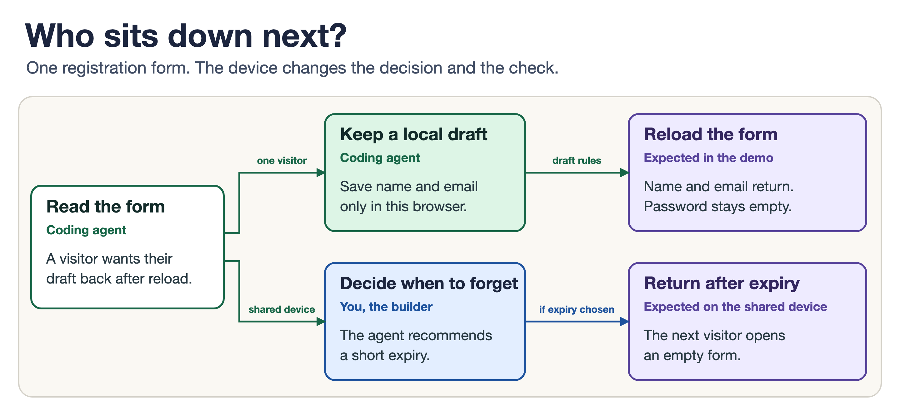

# Super-Outer

Super-Outer is an MIT-licensed starter skill for non-technical people who want to build creatively with Claude Code or Codex. Tell your agent what someone should be able to do. It reads your project, recommends a change, and gives you something you can try for yourself.

## Try it on one form

**1. In your terminal**, from the project where you want to use the skill, run the Vercel skills installer. It requires [Node.js](https://nodejs.org/) 22.20 or later.

```sh
npx skills add Shivak11/super-outer --skill super-outer
```

**2. In Claude Code or Codex**, open that project and paste this request.

> Use super-outer. In my local demo, keep my name and email in the registration form if I reload. Start with a plan only.

**3. Read the reply.** Look for the form the agent found, which fields it would save, and what you would see after reloading. At this point you should still have your original files. When the plan fits, say **“Make that change in the local demo and run the checks.”**

**[Open the visual walkthrough](docs/walkthrough.html)** · On GitHub, choose **Download raw file**, then open `walkthrough.html` in your browser. The whole guide works offline in that one file.

If the installer fails or your agent cannot find the skill, check that you chose the host and project you are using. With a copy of this repository open, you can also ask the agent to read [the skill instructions](skills/super-outer/SKILL.md) and walk through the example there. If it cannot read your form, ask it to identify what it could see and which parts of its plan are assumptions.

## Who sits down next?

On your own computer, a draft saves retyping. On a shared one, the same feature could put your email in front of the next visitor.



*Follow the upper path for the original demo. Take the lower path when someone else will use the same browser.* [Full-size diagram](docs/draft-decision.svg)

- **One visitor.** The agent can choose a reversible default. Keep name and email in this browser, leave passwords out of the draft, and clear it after a successful submission.
- **Shared computer.** You decide how long someone’s details may remain. The agent should ask one question and give a pick. A short expiry preserves a brief interruption and costs a little implementation work. Someone else could still sit down before it expires. If visitors switch seats immediately, consider skipping saved drafts on that machine. Ask for a check of the option you choose.

## How much care does the change need?

The agent looks at your project rules, then the nearby code and tests, then what it can safely observe. It sizes the work by who could be affected if it goes wrong and how hard it would be to undo. All three levels can apply to the same form.

| Level | Your request | What to look for |
| --- | --- | --- |
| **Tiny** | “The button says Submt. Fix the spelling.” | Correct the label, look for the same typo elsewhere, run the cheapest relevant check. A few lines of feedback suffice. |
| **Local** | “Remember my draft in this demo.” | A short plan for one screen. Walk through typing, reloading, submitting and recovering from trouble. Check what the visitor sees. |
| **Wide** | “Change how we delete everyone’s saved registration details.” | A plan naming the people and data affected, what could go wrong, and how recovery would work. The agent asks you to confirm the scope before acting. |

If the agent has missed who else uses the form, say **“Treat this as wide. Show me who is affected and how we could back out.”**

## What would count as evidence?

Use a made-up name and email in the local demo. These are the expected results to compare with what your agent actually observes.

| Try this | Look for this |
| --- | --- |
| Enter a name, email and dummy password. Reload with browser autofill off. | The name and email return. The password field is empty. Ask the agent to check the saved draft also omits the password. |
| Make a demo submission fail. Reload and retry. | The ordinary fields survive the failed attempt so you can correct the entry. |
| Complete a successful submission. Reopen or reload the form. | The next registration starts empty. |
| Have the agent simulate blocked browser storage. Fill in the form and submit. | You can still complete the form. Reloading need not bring the draft back. |
| If you chose expiry, leave an unfinished draft and return after the agreed time. | The next visitor sees empty fields. |

A useful handoff names the changed file, the action tried, the result seen and what remains untested. If all you get is “tests passed,” ask **“Which fields came back after reload? Which stayed empty? Show me the result.”** If a check failed or could not run, keep that outcome open. A local browser result leaves other devices, accessibility, the real server and release status open until someone checks them.

## Who has permission?

**You set the scope.** “Plan only” ends with advice. To stop work, say **“Pause here. Show me what you changed.”** If you want to back out, review the edits, then ask the agent to undo only its form change and rerun the original check. Keep unrelated work intact.

**The skill guides the agent.** The installer adds [SKILL.md](skills/super-outer/SKILL.md) and two short references covering [user journeys](skills/super-outer/references/journey-walkthrough.md) and [evidence](skills/super-outer/references/evidence-and-release.md). The skill consists of text. It has no hooks, credentials, background service, telemetry or permission controls. The host still uses its usual model service and permitted tools.

**Claude Code or Codex controls tool access.** If the host asks to use a tool, review the action there. If you deny it, the agent should stop that action, respect the denial and say which check it could not make. Skill guidance depends on the model following it. Your host settings, review and backups still matter. [See how the parts connect](docs/architecture.md)

## What has been evaluated?

From a copy of this repository with Node.js available, run the grader’s offline self-test. The grader is separate from the installed skill.

```sh
node evals/check.mjs --self-test
```

Expected output: `Self-test passed for 6 fixtures, including negative controls. No model called.`

The initial tools-disabled Claude Code spot checks passed 6 of 6 structural checks for draft reload, 5 of 6 for the typo and 5 of 6 for a denied read. Both partial results misplaced an evidence-limit tag. Codex CLI did not start in that evaluation, so it has no model result. These results describe three responses. They leave everyday reliability and the effect of adding the skill unmeasured. [Initial evaluation receipt](docs/evaluation-receipt.md) · [Run the cases and review the responses](docs/evals.md)

Contributions that improve the wording, examples or synthetic cases are welcome. [MIT license](LICENSE)
