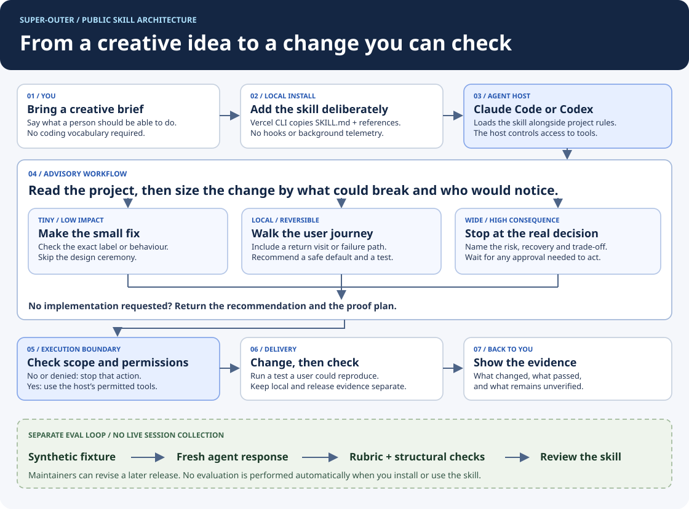
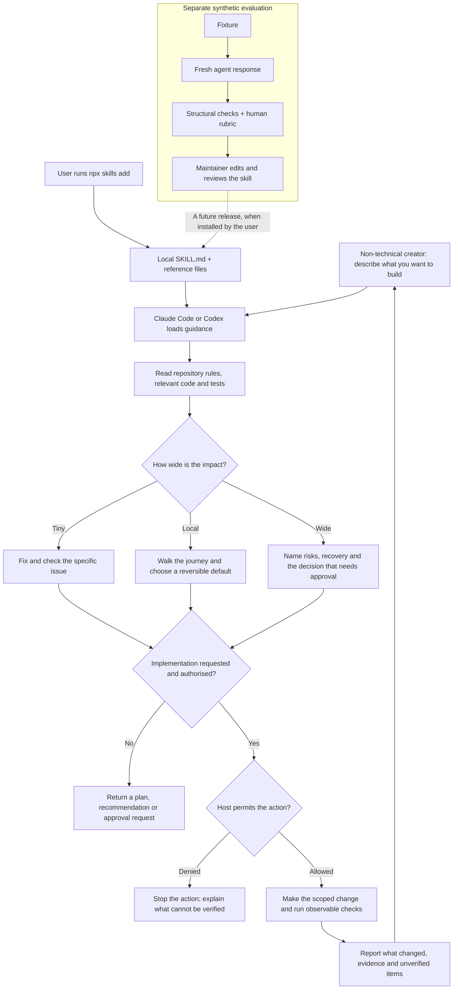

# Super-Outer architecture

*Read down the map for a builder’s session. The strip at the bottom belongs to a maintainer evaluating synthetic responses.* [Open the full-size architecture diagram](architecture.svg)

## Follow the connections

| Layer | Input | Output | Boundary |
|---|---|---|---|
| Installation | A user runs the Vercel skills CLI | A local skill with `SKILL.md` and optional references | No hook or background process is included. GitHub and the package registry are part of the user's chosen installer path. |
| Agent host | A creator’s request, accessible repository and loaded skill | Decisions, permitted tool calls and their results | Claude Code or Codex controls actual permissions. The skill cannot grant access. |
| Review lanes | Repository evidence, affected users and reversibility | A direct fix, a bounded workflow plan or a wider approval decision | Stop at plan-only scope, an unresolved high-impact decision or a host refusal. |
| Delivery | A requested, permitted change | Test outputs and a short explanation of what is still unverified | A local smoke test is not deployment proof. |
| Evaluation | Synthetic case and model response | Structural checks and a human rubric | Run separately. No background collection of real prompts. |

For the registration form, the owner supplies the goal and the agent finds the relevant form and tests. A plan-only request ends with a recommendation. If implementation is requested, the agent checks that the work fits the confirmed scope and that the host permits the tools. A denial stops that action. An allowed local change leads to a check the owner can repeat. The evidence comes back to the owner, who can accept the change, ask for another check or request an undo.

The separate evaluation path begins with a [synthetic case](../evals/cases.json). The [grader](../evals/check.mjs) compares a supplied response with six structural expectations and prints the case’s human rubric. A maintainer reads the response before deciding whether to revise the instructions. A later revision reaches a user through installation.

## Follow the draft decision

The [registration-form diagram](draft-decision.svg) follows one choice inside the Local example. One visitor gets a browser-only draft. When the device is shared, the owner chooses what may be retained. If expiry is chosen, the check moves from an immediate reload to a return after the agreed period. Passwords stay out of the draft on both paths.

Its sources are [Example A in the skill](../skills/super-outer/SKILL.md) and the [shared-device journey](../skills/super-outer/references/journey-walkthrough.md). If those rules change, update the SVG, its [PNG copy](draft-decision.png), the [README](../README.md) and the [offline walkthrough](walkthrough.html) together.

## Editable diagram

*The editable map follows the same two paths described in [Follow the connections](#follow-the-connections).*
