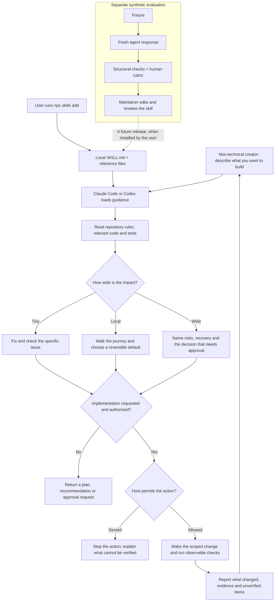

# Super-Outer architecture

The skill is a portable engineering workflow. It makes the creative brief and the test of success explicit; the coding host executes tools and enforces permissions. Running the installer is a separate act by the user.

| Layer | Input | Output | Boundary |
|---|---|---|---|
| Installation | A user runs the Vercel skills CLI | A local skill with `SKILL.md` and optional references | No hook or background process is included. GitHub and the package registry are part of the user's chosen installer path. |
| Agent host | A creator’s request, accessible repository and loaded skill | Decisions, permitted tool calls and their results | Claude Code or Codex controls actual permissions. The skill cannot grant access. |
| Review lanes | Repository evidence, affected users and reversibility | A direct fix, a bounded workflow plan or a wider approval decision | Stop at plan-only scope, an unresolved high-impact decision or a host refusal. |
| Delivery | A requested, permitted change | Test outputs and a short explanation of what is still unverified | A local smoke test is not deployment proof. |
| Evaluation | Synthetic case and model response | Structural checks and a human rubric | Run separately. No background collection of real prompts. |

## Editable diagram

