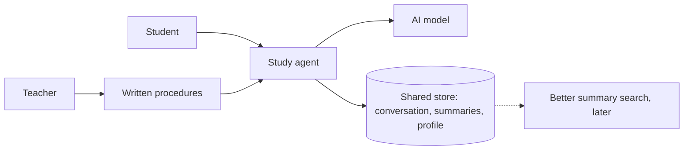

# Story walk

Before building a new product, feature, overhaul or subsystem, walk one named
customer's story through the simplest design that could work, and fix only the
failures the walk finds. Each fix uses the method strong teams use for that
failure, and each one is marked for now or for later. The method is adapted
from Sanjay Kumar's video on agent memory (youtu.be/4KvVWNUTd9g), which builds
an agent by following one customer through real moments and adding one part
each time the design fails him. Super-outer applies the same loop to every kind
of system: web and mobile apps, agents, agent memory, games, simulations and
user interfaces.

Contents:

- [The five steps](#the-five-steps)
- [The seven production checks](#the-seven-production-checks)
- [The story](#the-story)
- [The walk table](#the-walk-table)
- [When a fix depends on the owner](#when-a-fix-depends-on-the-owner)
- [Recording later fixes](#recording-later-fixes)
- [The diagram](#the-diagram)
- [The architecture pack](#the-architecture-pack)
- [The stack recommendation](#the-stack-recommendation)
- [Show the plan, then wait](#show-the-plan-then-wait)
- [Example: the study-buddy agent](#example-the-study-buddy-agent)

The walk runs after the [product brief](product-brief.md) and the
[journey map](journey-map.md) are written and before
the [engineering approach](engineering-approach.md) stage writes its See, Stop
and Shape lines. The walk decides what to build. The approach stage still
decides how the build is checked, and the walk does not change that stage. A
fix, regression or maintenance task never runs a walk.

## The five steps

1. **Write the story.** Name one customer who fits the brief's users and write
   the moments from the journey map's `Launch` rows: as many as those rows
   need, usually 8 to 14. Include a return visit, a busy hour and something
   going wrong.
2. **Start from the simplest design that could work.** This is usually one box:
   one managed app and one managed database, or one agent and one AI model.
3. **Walk the story one moment at a time.** At each moment, ask whether the
   current design does the right thing for this person, and apply the seven
   production checks below.
4. **Fix each failure with the smallest known fix** from the architecture pack,
   and say in one sentence why it is needed. When the right fix depends on
   what the owner wants, it becomes a question in the story's terms.
5. **Mark every fix now or later.** A later fix names the measured signal that
   makes it necessary. The diagram grows only by the parts the story needed.

## The seven production checks

At every moment, check what happens when:

1. many people do this at the same moment;
2. they come back later;
3. something is slow or down;
4. someone misuses it;
5. each use costs money;
6. someone other than a developer must change it;
7. data must be kept or deleted.

A check that finds nothing adds nothing. A plain product whose story finds no
failure keeps one box: one managed app and one managed database.

## The story

- Give the customer a real name that fits the brief's users, such as Priya, a
  second-year student.
- For an AI agent product, the moments also cover time: coming back to
  unfinished work days later, a run that outlasts the open tab, a failure
  halfway through a change, "this is not working" with no detail, a reference
  to their other work, a habit stated once, and wanting an earlier version
  back. The [agent library](archetypes/ai-agent-product.json) and the
  [agent pack](architecture-packs/ai-agents-and-harnesses.md) list them with
  their smallest fixes.
- Write each moment as one sentence about what the customer does or says.
- Take the moments from the [journey map](journey-map.md): the most common
  action first, then every other phase marked `Launch`. Each such phase gives
  at least one moment or is written as covered by another row. Each person in
  the map with a `Launch` row gets at least one moment.
- A repository with no map yet takes its moments from the brief: the most
  common action first, then the moments its facts imply, such as a payment,
  an upload, a deletion or a launch-day rush.

## The walk table

| Moment for <name> | What goes wrong with the simplest design | What we add | When |
|---|---|---|---|

Save the table in the product brief's Design section or in the intent record
for the surface. Super-outer looks there for a row header starting
`| Moment for`: until it finds one, planning messages name the unchecked
moments and saving a build plan shows the owner a notice. When the owner
changes a requirement later, update the rows it affects in the same file; a
scope change, such as a new audience or a new place the product runs, gets new
rows walked for it ([requirement changes](requirement-changes.md)).

- "Nothing" is a valid entry in the second column. It shows the moment was
  checked.
- "What we add" names the part in plain words, such as "a short summary of each
  session", and never names a product.
- "When" is one of three entries:
  - **Now** for a fix the brief's facts already require;
  - **Now, if you want this (question N)** for a fix that waits on the owner;
  - **Later, when <measured signal>** for a fix that a measured signal
    triggers, such as "when any student passes about 200 sessions".

These match the sequence classes in [SKILL.md](../SKILL.md): Now is `now`,
"Now, if you want this" is `decide`, and Later is `defer`.

## When a fix depends on the owner

Turn the choice into a question about the customer in the story, with a
recommended answer. Ask it in the brief's interview rounds, under the brief's
relevance test, and follow [plain-English questions](plain-english-questions.md).
Ask "When Priya comes back tomorrow, should it already know what you
discussed?" and never "Should we add episodic memory?". The interview sits
outside the per-task question allowance.

## Recording later fixes

Write every Later row to the deferral ledger at
`.engineering/super-outer/ledger.json`, using the entry shape that
`recordDeferrals` in `src/sequencing.mjs` writes. Entries sit inside
`{ "schema_version": "1.0.0", "entries": [...] }`. Read the file, append to
`entries` without reusing an existing `id`, and write the whole object back. A
file without an `entries` array reads as empty, and the next write would erase
every earlier deferral.

```json
{
  "id": "walk-summary-search",
  "prompt": "Add better search over session summaries when any student passes about 200 sessions",
  "why": "Searching one student's summaries slows down as their number grows; 200 is a judgement, so measure search time per student",
  "archetype": null,
  "status": "DEFERRED",
  "revisitWhen": ["session_summaries", "summary search"],
  "measuredWhen": [
    {
      "metric": "max_sessions_per_student",
      "comparison": ">=",
      "threshold": 200,
      "says": "any student passes about 200 sessions"
    }
  ],
  "recorded_at": "2026-10-12"
}
```

- Write the measured signal and the source of its threshold, or the word
  "judgement", in `prompt` and `why`.
- An entry becomes due in either of two ways, and one is enough.
  - `revisitWhen` lists terms that will appear in the code when that area
    grows, such as a table name. The repository search finds them.
  - `measuredWhen` lists numbers measured outside the code, such as how busy
    the database is at peak. Each condition names a `metric`, a `comparison`
    (`>`, `>=`, `<` or `<=`), a numeric `threshold`, and `says`: the signal in
    the owner's words, which the report repeats. Give every Later row with a
    measured signal a `measuredWhen` condition.
- The owner or a CI job writes the current numbers to a small file, such as
  `{ "measured_at": "2026-10-12", "metrics": { "max_sessions_per_student": 214 } }`,
  and runs `super-outer ledger check --metrics <file>`. Without `--metrics` the
  command runs only the repository search. It lists each part that is due and
  the number that made it due. It names any metric the file did not supply, so
  a number nobody measured never reads as "not due yet". It changes nothing in
  the ledger.
- Routing runs the repository search by itself on every routed prompt, so the
  owner hears about a part that has come due without anyone running the
  command. Each due part is said once per session. Routing has no metrics
  file, so parts that wait on a number become one line saying how many wait
  on numbers nobody has supplied.
- Use the same metric name in the ledger and in the metrics file. Name the
  metric for what is counted and its unit, such as `db_peak_busy_percent`.
- Keep Later rows few. Past ten open entries the ledger reads as a wishlist.
- List the same rows in the brief's Deferred section with their triggers.

## The diagram

Save a small Mermaid figure in the brief's Design section. It holds only the
parts the walk added. Draw Later parts with dashed lines.



## The architecture pack

Each fix comes from an architecture pack for the kind of system. Look for one
in this order:

1. the project's own pack at `.engineering/super-outer/architecture/<kind>.md`;
2. a built-in pack under `references/architecture-packs/`, which today holds
   [web and mobile apps](architecture-packs/web-and-mobile-apps.md) and
   [AI agents and their harnesses](architecture-packs/ai-agents-and-harnesses.md);
3. otherwise, run the
   benchmark researcher agent (`super-outer:benchmark-researcher`) in
   architecture mode with the kind of system and the brief's generic facts.
   Show one line first, such as "Looking up how memory for AI agents is built
   today (about 2 minutes)."

- A pack whose revisit-by date has passed is researched again before use.
- Save a newly researched pack to the project path so later tasks reuse it.
- A pack marked `low_confidence`, or one resting on thin or mostly secondary
  sources, is labelled as low confidence in the recommendation and is never
  saved for reuse.

## The stack recommendation

Recommend one stack that carries every fix the walk kept and every line of the
journey map's launch list and dependencies, and one runner-up. Judge both on
these criteria:

- it fits the fixes the story needed;
- managed services over self-run ones, unless the budget or the law says
  otherwise;
- it matches what the project already uses;
- AI coding agents write it reliably, because widely used, well-documented
  stacks are written more correctly;
- its cost at the brief's scale and at ten times that scale, always read from
  current pricing pages and never remembered;
- the data can be exported and the product can move away;
- it is actively maintained.

Write the trade-off between the two in plain words, then ask the owner to
accept the recommendation or pick the runner-up, as described in
[decision kinds](decision-kinds.md). Never offer an open list of tools. Save
the result in the brief's Stack section with the reason.

## Show the plan, then wait

Show the owner each person's journey table, the launch list and the
dependencies from the [journey map](journey-map.md), then the walk table, the
now-and-later parts and the stack with its runner-up, and build nothing until
the owner replies. This holds when the owner
skipped every question or asked for defaults: defaults replace answers, never
the owner's look at the plan. The implementation starts only after the owner
has seen the design it builds.

## Example: the study-buddy agent

The request was "Build me a study-buddy agent that remembers each student
across the semester." The brief is in the [product brief](product-brief.md)
example.

| Moment for Priya | What goes wrong with the simplest agent | What we add | When |
|---|---|---|---|
| Asks "explain recursion" | Nothing | The agent and an AI model | Now |
| Asks "another example?" | It forgot the last message | The current conversation, sent with each question | Now |
| 800 students online at 9 pm in exam week | Several copies of the app are running, and the conversation sits in one of them | The conversation kept in one shared store | Now |
| Returns next day: "continue from yesterday" | It knows nothing about yesterday | A short summary of each session, searched by student and date | Now, if you want this (question 1) |
| Says "I learn better with diagrams" | Lost after the session ends | A small profile of each student's preferences | Now (question 2 decides who can see it) |
| A teacher wants answers to follow the marking scheme | Rules are buried in the code | Written procedures the agent follows | Now; question 3 decides where they live |
| 2,000 students, 3 sessions a week each | The AI bill grows with chat length | Send summaries rather than full history | Now (fits question 4's budget) |
| One student has 300 sessions | Searching summaries slows down | Better search over summaries | Later, when any student passes about 200 sessions |

Questions, each with a recommended answer that "yes" accepts:

1. When Priya comes back tomorrow, should it already know what you discussed?
   Recommended: yes, the last few sessions.
2. Should students be able to see and delete what it remembers about them?
   Recommended: yes.
3. Who will edit the marking-scheme instructions, you or the teachers?
   Recommended: teachers, so they live outside the code.
4. What can you spend on AI per student per month? You name a ceiling.

The reply ends with one recommended design and stack, named from that day's
research, the runner-up, and the trade-off in plain words. A chat app, a
multiplayer game, a simulation or a screen flow runs through the same steps
with its own story and pack.
